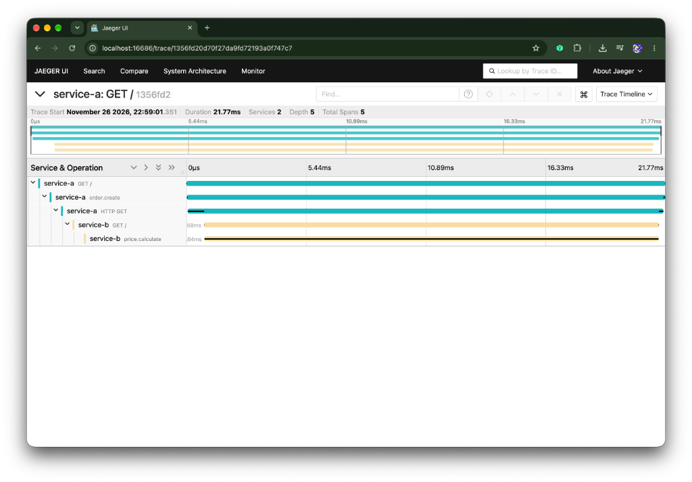

# Task 3.1: Трейсинг с OpenTelemetry и Jaeger в Kubernetes

Два Go-сервиса (`service-a` - сервис заказов, `service-b` - сервис расчета стоимости) с OpenTelemetry SDK и Jaeger в Kubernetes (Docker Desktop).

При запросе `GET /` к `service-a` он создает спан `order.create`, вызывает `GET /` в `service-b` с пробросом W3C `traceparent` и возвращает JSON с `order_id`, `price` и общим `trace_id`. Спаны отправляются в `http://simplest-collector:4318`.

## Запуск

Из корня репозитория:

```bash
# Установка cert-manager, jaeger-operator, simplest, сборка образов, деплой и тест
make task3-all

# Открыть Jaeger UI на http://localhost:16686
make task3-ui

# Удалить сервисы и инстанс Jaeger
make task3-clean
```

## Результат в Jaeger UI


